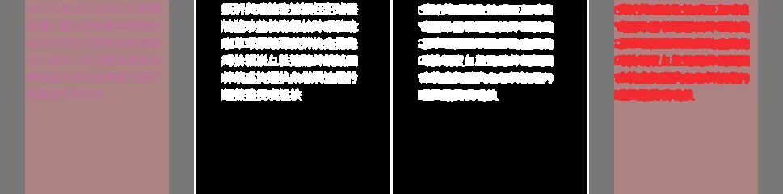
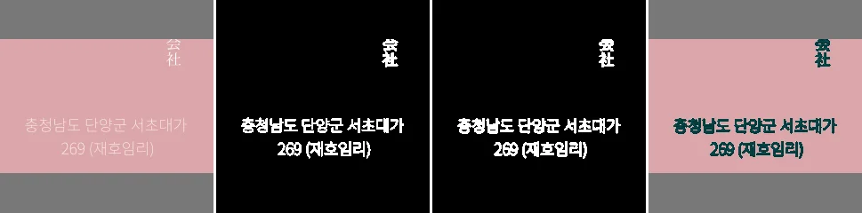
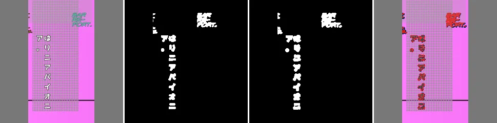
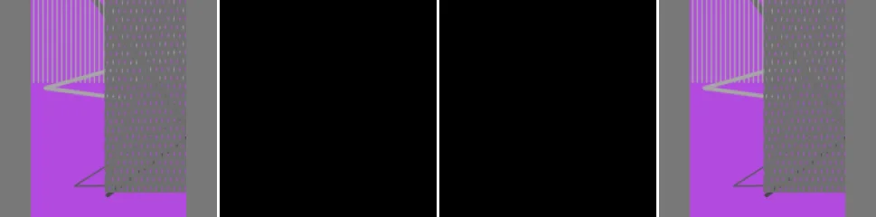
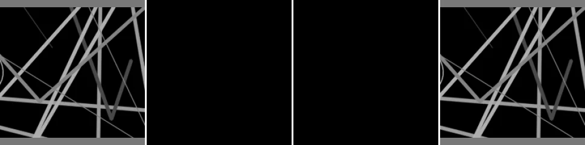
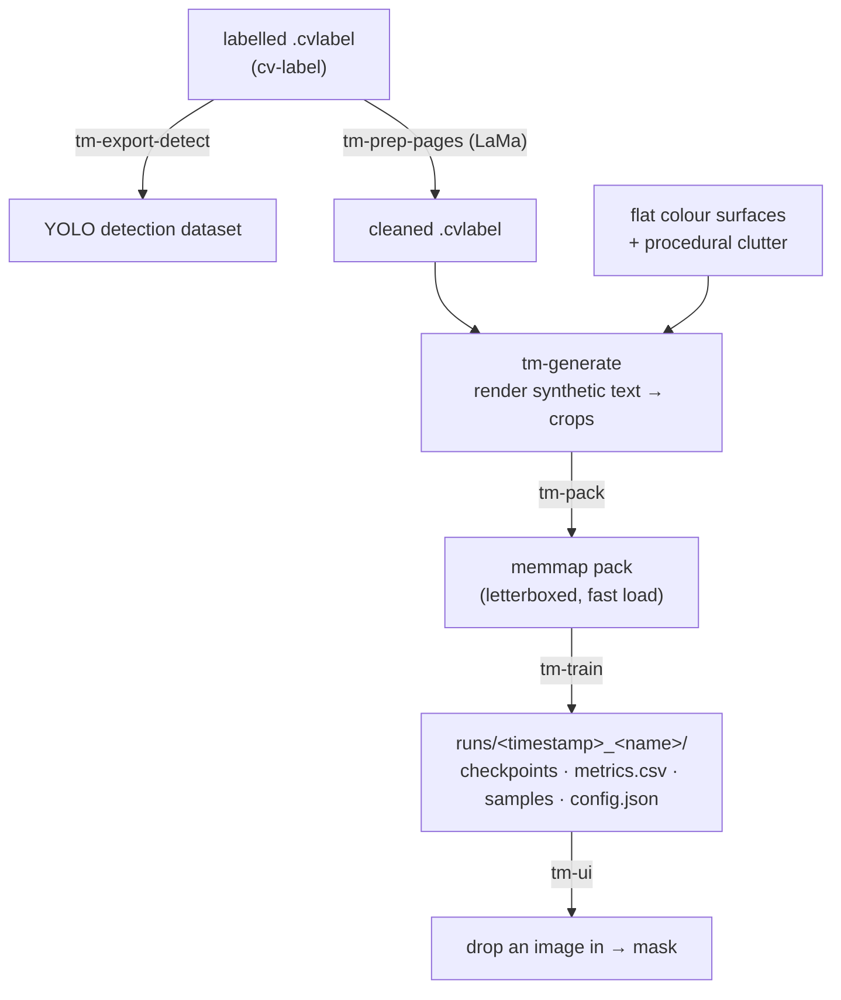

# comic-localizer-text-masking

Synthetic data + training for the comic-localizer **text-mask segmenter** — a
binary pixel classifier ("text vs not-text") that runs on detector crops and
feeds the localizer's cleaner. Detecting *where* text is / grouping it into OCR
units is the detector's job, not this model's.

## Examples

Held-out synthetic crops (flat procedural surfaces + clutter, no real pages) run
through the trained model — each strip is **sample · ground truth · predicted ·
predicted overlay**. Note the multi-script coverage, vertical Japanese, low
contrast, and clutter / screentone / line-screen rejection.








## Install

```bash
uv sync
```

Installs the `text_masking` package (src layout) plus `comic-localizer`, pulled
straight from [its repo](https://github.com/TareHimself/comic-localizer)
(`localizer/` subdirectory) and pinned in `uv.lock`. Fonts live in `fonts/`
(git-ignored — see `fonts/FONTS.md`); generated data and runs go under `data/`
and `runs/` (both ignored).

Labels are authored and inspected in **[cv-label](https://github.com/TareHimself/cv-label)**;
the `.cvlabel` archive format is [documented there](https://github.com/TareHimself/cv-label/blob/main/formats/cvlabel/SPEC.md).

## Pipeline



### Labels (cv-label)

Both naming conventions are accepted:

| role | labels | shape |
|---|---|---|
| inpaint out | `Text` / `Text In Bubble`, `Text on Page` | polygon (tight) |
| bubble draw area | `Speech Bubble` / `Bubble` | box |
| free-text draw area | `Free Draw Area` | box |

### Commands

Every `tm-*` command takes `--config <file>` (YAML or JSON) for its defaults;
`--flags` on the command line override the file. Pass `--help` to any of them
for the full option list.

```bash
# 1. clean labelled pages — inpaint the text out (needs a LaMa torchscript)
tm-prep-pages --labels labelled.cvlabel --out data/cleaned.cvlabel --cleaner_model lama_cleaning.pt

# 2a. synthetic dataset — flat colour surfaces + procedural clutter
tm-generate --out data/syn --crops --train 8000 --val 800 --workers 12

# 2b. synthetic text rendered onto the real cleaned pages (page × 4 flips × repeats)
tm-generate --backgrounds data/cleaned.cvlabel --out data/real --crops --repeats 30 --workers 12

# 3. pre-render every crop into a letterboxed memmap pack (fast training I/O)
tm-pack --data data/syn data/real --out data/packed_384 --imgsz 384 --workers 12

# 4. train  (see "Training" below)
tm-train --config train.yaml --name syn-real-v1

# detector dataset from the same labels (independent of the mask pipeline)
tm-export-detect --labels labelled.cvlabel --out data/detect_dataset
```

`--crops` emits one crop per labelled region (plus some text-free negatives)
instead of whole pages — this matches how the model is used at inference (on
detector boxes, not pages), so always train with it. Expect the crop count to
be ~2× the `--train` / `pages × flips × repeats` figure.

## Training

`tm-train` reads one or more **packed** dataset roots, concatenating each root's
`train/` and `valid/` splits. It always writes a fresh, self-contained run
directory — nothing is overwritten between runs.

```bash
tm-train --config train.yaml --name syn-real-v1     # normal run
tm-train --config train.yaml --smoke                # 12 epochs on 800 samples — is the wiring OK?
tm-train --data data/packed_384 --encoder resnet34  # override anything from the file
tm-train --config train.yaml --init latest --name v2 # continue from the last run's best.pt on new data
```

The repo ships a `train.yaml` with sensible defaults for a ~16 GB GPU. Key
options (CLI flag = YAML key):

| option | default | notes |
|---|---|---|
| `data` | `[./data/mask_dataset]` | list of `tm-pack` roots; splits are concatenated |
| `name` | — | run dir is `runs/<timestamp>_<name>/` |
| `arch` | `unet` | `unet` or `fpn` |
| `encoder` | `resnet18` | any `segmentation-models-pytorch` encoder; this task is encoder-light — try `resnet34` only if stylised/SFX text is missed |
| `init` | — | warm-start weights from a checkpoint: a run's `best.pt`, a run dir, or `latest`. Fresh optimiser / schedule / epoch count — just the weights. `arch`/`encoder` must match |
| `imgsz` | `384` | must match the pack's `imgsz`; 512 gives crisper edges on thin text at ~1.8× cost |
| `batch` | `32` | 64 fits a 16 GB card at 384 |
| `lr` | `3e-4` | AdamW + cosine decay over `epochs` |
| `epochs` | `80` | |
| `patience` | `5` | stop if val IoU stalls this many epochs (`0` = off) |
| `workers` | `12` | dataloader processes |
| `wandb` | `false` | logs to project `text-mask-seg`; the run's wandb files land *inside* the run dir |
| `smoke` | `false` | quick wiring check: 12 epochs, 800-sample cap |
| `limit` | `0` | cap train samples (`0` = all) |

AMP is on automatically on CUDA. `Ctrl-C` is caught — the current `best.pt` /
`last.pt` are kept and wandb closes cleanly.

**Provenance** — every `tm-generate` output carries a `manifest.json` (source
`.cvlabel`, repeats, seed, languages, fonts, crop count); `tm-pack` folds those
into each pack's `meta.json`, and `tm-train` writes a per-split `data_summary`
(e.g. `train: 15228 flat + 13411 cleaned.cvlabel[train]×30`) plus the full
`data_sources` tree into `config.json` and the wandb config.

**Curves from step 0** — the untrained model is evaluated before epoch 1 and
logged at step 0, and training loss is logged every 20 optimiser steps, so wandb
shows real curves partway through the first epoch instead of a single point.

### What a run produces

```
runs/20260830-142530_syn-real-v1/
├── config.json              resolved config for this run
├── metrics.csv              epoch, train_loss, lr, val_iou/precision/recall
├── train.log                same lines printed to the console
├── checkpoints/
│   ├── best.pt              highest val IoU so far  ← use this
│   └── last.pt              most recent epoch (resume / inspect)
├── samples/epoch_NNN.png    image | prediction | ground-truth strips, saved when IoU improves
├── wandb/                   only with --wandb
└── wandb_url.txt
```

Each `.pt` bundles the weights plus `arch` / `encoder` / `imgsz` / `metrics`, so
inference needs only the file.

### Inspecting a model

```bash
tm-ui                                              # loads the newest run's best.pt
tm-ui --checkpoint runs/<run>/checkpoints/best.pt  # a specific one
```

Drop an image in and get the overlay, binary mask, and probability heat-map,
with live threshold / dilation sliders. Because the combined val IoU is mostly
synthetic, judge real performance here on held-out manga crops.

## Package layout (`src/text_masking/`)

| module | what |
|---|---|
| `cvlabel` | `.cvlabel` archive read/write |
| `languages` | `Language`, `LanguageSet`, `LanguageCycler`, `default_languages()` |
| `fonts` | font loading, hyphenation, per-font glyph-coverage pools (`charset_text`) |
| `color` | `ColorGenerator`, contrast-safe text/outline colour |
| `layout` | word-wrap (horizontal + vertical RTL), font-size fitting |
| `render` | `TextSpec`, `place_text`, `compose` — the core primitive |
| `geometry` | boxes, `letterbox` |
| `clutter` | procedural non-text clutter (strokes, screentone, …) |
| `surface` | flat-colour surfaces |
| `page` | labelled-page ops: flip, `bubble_text_box` (via `compute_draw_bbox`), scatter |
| `spec` | `SpecMaker` — a box + its background → a randomised `TextSpec` |
| `crops` | cut a composed page into per-region crops + negatives |
| `parallel` | shard generation across processes |
| `dataset` | `generate` / `generate_from_backgrounds` |
| `pack` | letterbox + memmap packing |
| `clean` | LaMa inpainting of labelled text |
| `export` | `.cvlabel` → YOLO detection dataset |
| `seg/` | `data` (dataset), `model`, `train` (+ `run` = run-dir), `infer`, `ui` |
| `cli` | `tm-*` console entry points |

Text that doesn't need to make sense — ~40% of blocks are random-glyph runs
sampled evenly across a script and filtered to the font's cmap, so the model
sees rare kanji/hanzi/hangul. Japanese is set vertically ~half the time.
~22% of blocks are oversized (short, huge text — SFX / titles) and a quarter of
crops are cut tight enough that text runs off the edge; training then adds
random zoom-in (`_zoom`), all so tightly-cropped large text isn't OOD. Clutter +
real backgrounds are what stop the model becoming an edge detector.
